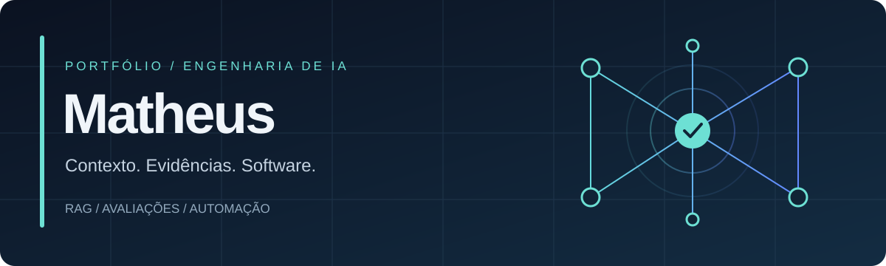

**IA aplicada · Automação · Engenharia de software**

Construindo um portfólio voltado à **Engenharia de IA**, com foco em sistemas que podem ser executados, avaliados e explicados.

[RAG e avaliações](https://github.com/MatheusSBCastro/evidence-rag) · [Automação com IA](https://github.com/MatheusSBCastro/ArrumaeEnvia) · [Aplicação web](https://github.com/MatheusSBCastro/ProjetoWM)

## Projetos para começar

| Projeto | O que você encontra | Onde olhar |
| --- | --- | --- |
| **[Evidence RAG](https://github.com/MatheusSBCastro/evidence-rag)** | Recuperação BM25 em português, fontes verificadas, saída estruturada e adapter opcional para a Responses API. | [Código](https://github.com/MatheusSBCastro/evidence-rag/tree/main/src) · [Avaliação reproduzível](https://github.com/MatheusSBCastro/evidence-rag/blob/main/evals/report.json) |
| **[Arruma e Envia](https://github.com/MatheusSBCastro/ArrumaeEnvia)** | Workflow assistido por IA para currículo, seleção de vagas e acompanhamento local de candidaturas; CLI com exemplos fictícios. | [Demonstração e uso](https://github.com/MatheusSBCastro/ArrumaeEnvia#ferramentas-locais) · [Testes](https://github.com/MatheusSBCastro/ArrumaeEnvia/tree/main/tests) |
| **[Gym Moviment · MVP](https://github.com/MatheusSBCastro/ProjetoWM)** | Aplicação Node/Express com perfis de acesso, treinos, check-in e testes de API e navegador. | [Arquitetura](https://github.com/MatheusSBCastro/ProjetoWM#arquitetura-e-decisões) · [Código](https://github.com/MatheusSBCastro/ProjetoWM) |
| **[UI/UX Stefano](https://github.com/MatheusSBCastro/UI-UX-Stefano)** | Kit de interfaces com React, TypeScript e Motion, com componentes e adaptações creditados. | [Demonstração e configuração](https://github.com/MatheusSBCastro/UI-UX-Stefano) |

## Meu foco técnico

- **Engenharia de IA:** recuperação de contexto, integração com LLMs, contratos de saída e avaliações reproduzíveis.
- **Automação:** ferramentas de linha de comando, validação de entradas e acompanhamento de fluxos.
- **Aplicações:** APIs em Node.js, interfaces JavaScript/React e testes com Node e Playwright.

Uso IA como ferramenta de desenvolvimento. Procuro deixar visíveis as decisões, as fontes de terceiros, o que foi testado e o que ainda precisa de validação. Os projetos são evidências de trabalho e aprendizado; os READMEs detalham o alcance de cada implementação.

## Como avaliar este portfólio

O **Evidence RAG** executa sem chave de API e publica uma avaliação offline pequena. O modo com LLM está implementado, mas ainda não foi validado com uma chamada real. O **Arruma e Envia** oferece uma demo local, e suas ações em sites dependem das ferramentas e da autorização da pessoa. O **Gym Moviment** permite inspecionar regras de negócio e testes de uma aplicação completa.

**Vamos conversar?** Você pode abrir uma [discussão no perfil](https://github.com/MatheusSBCastro/MatheusSBCastro/discussions) sobre os projetos e oportunidades em Engenharia de IA.

AI engineering portfolio · Retrieval, structured outputs, evaluation and practical automation.
