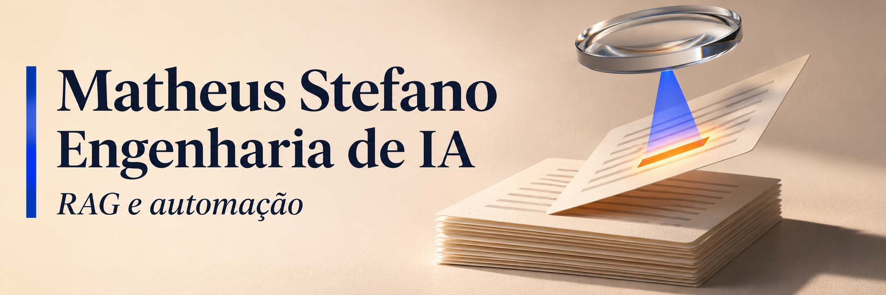
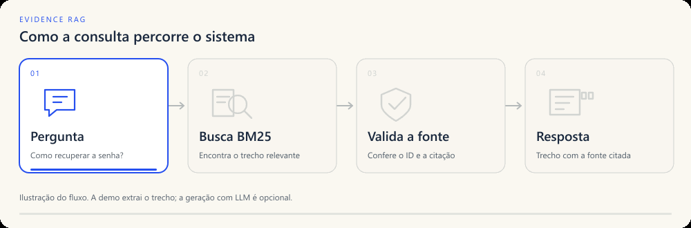

Estou direcionando meus projetos para Engenharia de IA. Trabalho com recuperação de documentos, automação e aplicações web.

Aqui você encontra o código, os testes e as decisões de cada projeto.

[RAG e avaliações](https://github.com/MatheusSBCastro/evidence-rag) · [Automação com IA](https://github.com/MatheusSBCastro/ArrumaeEnvia) · [Aplicação web](https://github.com/MatheusSBCastro/ProjetoWM)

<picture>
  <source media="(prefers-reduced-motion: reduce)" srcset="assets/rag-flow-static.png">
  
</picture>

## Projetos para começar

| Projeto | O que você encontra | Onde olhar |
| --- | --- | --- |
| [Evidence RAG](https://github.com/MatheusSBCastro/evidence-rag) | Busca documentos em português com BM25, confere as citações e retorna uma resposta estruturada. Tem integração opcional com a Responses API. | [Código](https://github.com/MatheusSBCastro/evidence-rag/tree/main/src) · [Avaliação reproduzível](https://github.com/MatheusSBCastro/evidence-rag/blob/main/evals/report.json) |
| [Arruma e Envia](https://github.com/MatheusSBCastro/ArrumaeEnvia) | Um agente de IA ajuda a revisar currículos e selecionar vagas. A ferramenta de linha de comando acompanha as candidaturas, com exemplos fictícios. | [Demonstração e uso](https://github.com/MatheusSBCastro/ArrumaeEnvia#ferramentas-locais) · [Testes](https://github.com/MatheusSBCastro/ArrumaeEnvia/tree/main/tests) |
| [Gym Moviment · MVP](https://github.com/MatheusSBCastro/ProjetoWM) | Aplicação Node/Express para treinos e check-in, com permissões por perfil e testes da API e do navegador. | [Arquitetura](https://github.com/MatheusSBCastro/ProjetoWM#arquitetura-e-decisões) · [Código](https://github.com/MatheusSBCastro/ProjetoWM) |
| [UI/UX Stefano](https://github.com/MatheusSBCastro/UI-UX-Stefano) | Kit de interfaces em React, TypeScript e Motion. Os componentes reutilizáveis e as adaptações têm os devidos créditos. | [Demonstração e configuração](https://github.com/MatheusSBCastro/UI-UX-Stefano) |

## Meu foco técnico

No Evidence RAG, estudo como recuperar contexto para um modelo, definir o formato da resposta e avaliar os resultados. No Arruma e Envia, o foco é automatizar etapas de um processo sem perder o histórico nem aceitar dados incompletos.

A base desses projetos é engenharia de software: ferramentas de linha de comando, APIs em Node.js, interfaces JavaScript/React e testes com Node e Playwright.

Uso IA durante o desenvolvimento e documento as decisões, os componentes de terceiros e os testes. Cada README também registra as validações que ainda faltam. Este portfólio reúne meu trabalho e o que estou aprendendo.

## Como avaliar este portfólio

Comece pela demonstração do Evidence RAG: ela roda sem chave de API e inclui uma avaliação offline pequena. A integração com um LLM está implementada, mas ainda precisa de uma chamada real para ser validada.

O Arruma e Envia também tem demonstração local. Para agir em sites, ele depende das ferramentas do agente e da autorização da pessoa. No Gym Moviment, você pode acompanhar regras de negócio desde a interface até os testes do servidor.

Para conversar sobre os projetos ou oportunidades em Engenharia de IA, abra uma [discussão no perfil](https://github.com/MatheusSBCastro/MatheusSBCastro/discussions).

AI engineering portfolio · Retrieval, structured outputs, evaluation and practical automation.
